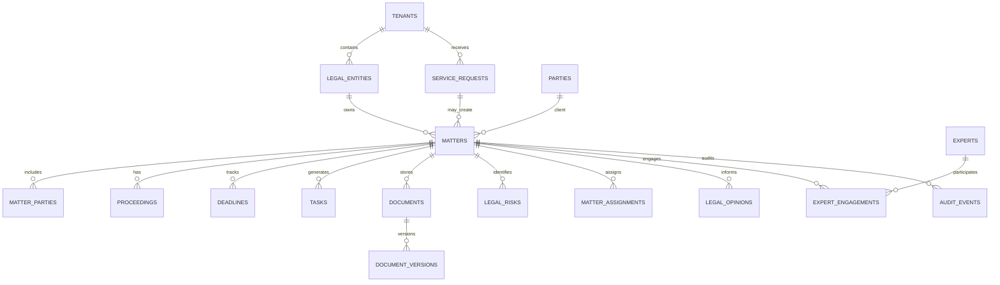

# معماری اجرایی و مدل داده سامانه جامع مدیریت حقوقی هلدینگ

- سند مرجع: معماری محصول و طراحی منطقی سامانه
- صفحه طرح مادر: `pages/holding-legal-center.html`
- کد طرح: `۰۲-۳-۱۰`
- وضعیت: معماری پیشنهادی برای بررسی، تصویب و تبدیل به طراحی تفصیلی
- اصل حاکم: تفکیک پرونده‌ها و داده‌های هر شخصیت حقوقی و هر موکل، محرمانگی حرفه‌ای، اختیار قانونی و ثبت کامل رویدادها

> این سند طرح فنی و مدل منطقی است؛ نه اعلام استقرار نرم‌افزار، نظر حقوقی درباره یک پرونده واقعی، تأیید انطباق با قانون کشور خاص یا اعطای اختیار وکالت و امضا. پیش از اجرا باید حوزه قضایی، قوانین لازم‌الاجرا، ساختار حقوقی شرکت‌ها، الزامات حفاظت داده و مقررات حرفه‌ای توسط متخصصان صلاحیت‌دار تأیید شود.

## ۱. هدف محصول و اصول معماری

سامانه باید چرخه کامل دریافت درخواست تا تعیین تکلیف، بایگانی و یادگیری سازمانی را پشتیبانی کند. محصول از چند حوزه عملیاتی مستقل اما متصل تشکیل می‌شود:

1. میز خدمت و مدیریت درخواست‌های حقوقی سازمانی و حمایتی.
2. پرونده‌ها و دعاوی قضایی، اداری، ثبتی، قراردادی و غیرقضایی.
3. قراردادها، تعهدات، ضمانت‌ها و بازبینی حقوقی.
4. شبکه حقوقدانان، وکلا، کارشناسان رسمی، داوران و مشاوران.
5. مشاوره، یادداشت حقوقی، هم‌اندیشی و اتاق امن پرونده.
6. داوری، میانجیگری، مذاکره و سازش.
7. ریسک حقوقی، تقویم مهلت‌ها و کنترل انطباق.
8. بانک دانش، قوانین و مقررات، رویه‌ها، الگوها و درس‌آموخته‌ها.
9. گزارش‌ها، شاخص‌ها، هزینه‌ها و نظارت مدیریتی مجاز.
10. هویت، مجوز، امنیت، ممیزی و مدیریت چرخه عمر اسناد.

### اصول غیرقابل مذاکره

- **مرجعیت پرونده:** هر پرونده یک مالک/موکل مشخص، یک شخصیت حقوقی یا شخص حقیقی ذی‌نفع و یک مسئول پاسخ‌گوی پرونده دارد.
- **جداسازی قلمروها:** داده پرونده شرکت الف نباید به شرکت ب یا پرونده حمایتی کارکنان قابل مشاهده باشد؛ حتی اگر هر دو از یک مرکز مشترک خدمت بگیرند.
- **تفکیک داده از مجوز:** عضویت در هلدینگ، مدیر بودن یا دسترسی به داشبورد به‌تنهایی مجوز مشاهده محتوای پرونده نیست.
- **اصل حداقل دسترسی:** دسترسی بر اساس نقش، پرونده، هدف، مدت، حساسیت و ضرورت اطلاع اعطا می‌شود.
- **عدم اقدام حقوقی خودکار:** ارسال دادخواست، شکایت، اقرار، سازش، اسقاط حق، اعطای وکالت یا امضای تعهد بدون تأیید انسانی و اختیار معتبر ممنوع است.
- **ردپای ممیزی تغییرناپذیر:** مشاهده و خروجی‌گرفتن از اسناد حساس، تغییر، تأیید، ارجاع، اعطای دسترسی و اقدام مهم باید ثبت شود.
- **نسخه معتبر:** اسناد و قوانین باید نسخه، منبع، تاریخ اثر، وضعیت اعتبار و سابقه جایگزینی داشته باشند.
- **هوش مصنوعی دستیار است، نه مرجع:** خروجی ماشینی پیش‌نویس یا پیشنهاد است و باید با منبع، درجه اطمینان و بازبینی متخصص ارائه شود.

## ۲. معماری منطقی سامانه

### ۲.۱ لایه‌های معماری

| لایه | اجزا | مسئولیت |
|---|---|---|
| تجربه کاربری | پرتال سازمانی، میزکار وکیل/حقوقدان، میزکار کارکنان، پنل مدیر مرکز، پنل متخصص بیرونی | نمایش متناسب با نقش، دسترس‌پذیری، فرم‌ها و گردش کار |
| درگاه و هویت | API Gateway، ورود یکپارچه، MFA، مدیریت نشست، مجوز و سیاست دسترسی | احراز هویت، کنترل درخواست، محدودسازی و ثبت دسترسی |
| خدمات دامنه | پرونده، درخواست، قرارداد، متخصص، نظر، اختلاف، ریسک، دانش، سند و گزارش | اجرای قواعد کسب‌وکار و گردش عمر هر موجودیت |
| گردش کار و رویداد | موتور گردش کار، صف کار، اعلان، زمان‌بند، رویداد دامنه | ارجاع، تأیید، یادآوری، تشدید و اتصال ماژول‌ها |
| داده و محتوا | پایگاه داده رابطه‌ای، مخزن امن اسناد، جست‌وجوی متن، نمای تحلیلی | نگهداری داده مرجع، فایل، نسخه و گزارش |
| یکپارچه‌سازی | APIهای نسخه‌بندی‌شده، وب‌هوک، صف پیام و تبادل دسته‌ای امن | اتصال به مالی، قرارداد، پروژه، منابع انسانی، هویت و مرکز اشراف |

### ۲.۲ الگوی استقرار پیشنهادی

برای نسخه نخست، **یکپارچه ماژولار (Modular Monolith)** با مرزبندی روشن دامنه‌ها پیشنهاد می‌شود؛ نه ریزخدمت‌های پراکنده از روز اول. این الگو پیچیدگی استقرار و عملیات را پایین نگه می‌دارد و امکان جداسازی سرویس‌ها در آینده را حفظ می‌کند.

ماژول‌های مستقل درون برنامه:
- Identity & Access
- Service Desk
- Matter & Litigation
- Legal Opinion & Research
- Contract Review
- Expert Network
- Dispute Resolution
- Legal Risk & Compliance
- Document & Evidence
- Knowledge Base
- Notification & Workflow
- Reporting & Audit

اجزای زیرساختی جدا:
- پایگاه داده تراکنشی رابطه‌ای؛
- مخزن اسناد رمزنگاری‌شده با نسخه‌بندی و کنترل دسترسی؛
- موتور جست‌وجوی متنی با فیلتر مجوز در سطح سند؛
- صف پیام برای اعلان و پردازش‌های غیرهمزمان؛
- مخزن گزارش تحلیلی جدا از پایگاه عملیاتی؛
- سامانه ثبت رویداد امنیتی و ممیزی.

ریزخدمت‌سازی فقط وقتی توجیه دارد که بار مستقل، الزام جداسازی، چرخه انتشار متفاوت یا مالکیت تیمی مشخص وجود داشته باشد. موتور جست‌وجو و مخزن اسناد می‌توانند از ابتدا اجزای زیرساختی مستقل باشند.

### ۲.۳ مرزبندی داده بین شرکت‌ها و اشخاص

هر رکورد عملیاتی باید دارای قلمرو مالکیت باشد. مدل پایه شامل این شناسه‌هاست:

- `tenant_id`: قلمرو سازمانی/مشتری سامانه؛
- `legal_entity_id`: شخصیت حقوقی صاحب پرونده یا خدمت؛
- `client_party_id`: موکل یا شخص ذی‌نفع؛
- `matter_id`: پرونده یا موضوع حقوقی؛
- `confidentiality_level`: سطح محرمانگی؛
- `access_policy_id`: سیاست دسترسی اختصاصی.

در داده‌های حمایتی، شخص کارکن/عضو خانواده موکل است و پرونده او نباید به پرونده کارفرمایی یا منابع انسانی پیوند قابل مشاهده خودکار داشته باشد. پیوندهای آماری فقط به‌صورت تجمیعی و فاقد محتوای مشاوره قابل ارائه‌اند.

جداسازی صرفاً با مخفی‌کردن دکمه در رابط کاربری کافی نیست؛ کنترل باید در لایه سرویس، پرس‌وجوی داده، مخزن فایل، جست‌وجو، گزارش، API و خروجی فایل اعمال شود. برای شرکت‌های با حساسیت بالا می‌توان پایگاه داده یا کلید رمزنگاری جدا در نظر گرفت.

## ۳. نقش‌ها و الگوی مجوزدهی

### نقش‌های پایه

| نقش | دسترسی معمول |
|---|---|
| متقاضی سازمانی | ثبت درخواست و مشاهده وضعیت درخواست‌های خودش |
| متقاضی حمایتی | مشاهده پرونده شخصی خود و پیام‌های مجاز |
| رابط حقوقی شرکت | ثبت و پیگیری درخواست‌های مجاز همان شرکت؛ بدون دسترسی عمومی به پرونده‌های دیگر |
| مسئول پرونده | دسترسی به پرونده‌های تخصیص‌یافته در محدوده قرارداد و صلاحیت |
| مدیر حوزه تخصصی | تخصیص و کنترل کیفیت در حوزه مجاز؛ نه مشاهده خودکار همه محتوای محرمانه |
| مدیر مرکز | ظرفیت، کیفیت و گزارش‌های مجاز؛ دسترسی محتوایی فقط در صورت نیاز و مجوز مشخص |
| وکیل/کارشناس بیرونی | دسترسی محدود، زمان‌دار و پرونده‌محور به اسناد و وظایف واگذارشده |
| مسئول اسناد | مدیریت چرخه سند در محدوده مجاز؛ بدون حق تغییر محتوای حقوقی |
| ممیز امنیت | مشاهده رویدادهای دسترسی و کنترل امنیت؛ نه محتوای پرونده مگر مجوز جداگانه |
| مدیر سامانه | اداره فنی؛ بدون دسترسی پیش‌فرض به محتوای پرونده‌ها |
| مرجع تصویب/امضای مجاز | مشاهده بسته تصمیم و ثبت تأیید در حدود تفویض اختیار معتبر |

### قواعد مجوز

- RBAC برای نقش‌های پایه و ABAC برای قلمرو شرکت، پرونده، سطح محرمانگی، نوع موکل، وضعیت تخصیص و زمان اعتبار.
- مجوز پرونده‌ای مستقل از نقش سازمانی؛ عضویت در یک گروه به‌تنهایی کافی نیست.
- دسترسی متخصص بیرونی با تاریخ شروع/پایان، فهرست اسناد مجاز، منع دانلود در صورت نیاز و لغو فوری.
- دسترسی اضطراری (Break-glass) با دلیل اجباری، زمان محدود، هشدار فوری و بازبینی پسینی.
- تعارض منافع پیش از مشاهده محتوای پرونده بررسی می‌شود؛ تا پایان بررسی، اطلاعات فقط در حداقل سطح لازم نمایش داده می‌شود.
- تفکیک وظایف: ثبت‌کننده، بررسی‌کننده، تأییدکننده و امضاکننده در اقدامات حساس تا حد امکان اشخاص جدا باشند.

## ۴. گردش‌های کاری کلیدی

### ۴.۱ درخواست مشاوره و خدمت حقوقی

1. متقاضی نوع درخواست، موضوع، فوریت، ذی‌نفع و مدارک اولیه را ثبت می‌کند.
2. سامانه کنترل کامل بودن، تکراری بودن، تعارض منافع اولیه و قلمرو درخواست را انجام می‌دهد.
3. کارشناس پذیرش، فوریت و مسیر خدمت را تأیید یا برای تکمیل بازمی‌گرداند.
4. مسئول/متخصص متناسب با حوزه و ظرفیت تخصیص می‌یابد.
5. تحلیل، پرسش تکمیلی، جلسه و پیش‌نویس نظر انجام می‌شود.
6. کنترل کیفیت و تأیید متخصص مسئول انجام می‌شود.
7. پاسخ از کانال مجاز ابلاغ و رضایت/بازخورد ثبت می‌شود.
8. در صورت نیاز، درخواست به پرونده، قرارداد، اختلاف یا اقدام اصلاحی تبدیل می‌شود.

وضعیت‌های پیشنهادی: `draft`, `submitted`, `triage`, `need_info`, `conflict_check`, `assigned`, `in_progress`, `review`, `answered`, `closed`, `rejected`, `cancelled`.

### ۴.۲ پرونده و دعوا

- ثبت پرونده و تعیین موکل/شخصیت حقوقی؛
- کنترل تعارض منافع و صلاحیت مرجع؛
- طبقه‌بندی حوزه، مرجع رسیدگی، طرفین، خواسته و ارزش تقریبی؛
- ثبت مهلت قانونی با منبع و تأیید انسانی؛
- تعیین مسئول پرونده و وکیل/کارشناس؛
- ایجاد برنامه اقدام، جلسات، تکالیف و اسناد؛
- ثبت مکاتبه، دادخواست، شکواییه، لایحه، ابلاغ، جلسه و رأی؛
- تصمیم درباره تجدیدنظر، اجرا، سازش یا اقدام بعدی با مرجع مجاز؛
- اختتام، ثبت نتیجه و درس‌آموخته؛
- بایگانی و نگهداری مطابق سیاست قانونی.

وضعیت‌های پرونده باید متناسب با نوع رسیدگی قابل تنظیم باشند؛ نمونه عمومی: `intake`, `conflict_hold`, `assessment`, `active`, `awaiting_external`, `hearing`, `decision_issued`, `appeal`, `enforcement`, `settled`, `closed`, `archived`. تغییر وضعیت باید دلیل، کاربر و زمان داشته باشد.

### ۴.۳ مهلت و تقویم حقوقی

هر مهلت دارای نوع، تاریخ/ساعت، منطقه زمانی، مرجع محاسبه، سند منشأ، شخص تأییدکننده، مسئول اقدام و سطح بحرانی است. استخراج خودکار تاریخ از سند فقط پیشنهاد ایجاد می‌کند؛ مهلت نهایی پس از بازبینی متخصص ثبت می‌شود. تعطیلات، قواعد شروع/پایان مهلت و تفاوت حوزه‌های قضایی باید قابل پیکربندی و تأیید حقوقی باشند.

### ۴.۴ شبکه متخصصان و اتاق هم‌اندیشی

- ثبت پروفایل، حوزه تخصص، سوابق، مدارک و وضعیت اعتبار پروانه؛
- بررسی هویت، صلاحیت، بیمه/مجوزهای لازم و قرارداد همکاری؛
- بررسی تعارض منافع قبل از افشای نام طرفین یا اسناد؛
- دعوت محدود به پرسش یا بسته اسناد پالایش‌شده؛
- ثبت نظر مستقل، منبع، فرض‌ها، محدودیت‌ها و امضای حرفه‌ای؛
- ثبت اختلاف‌نظرها به‌جای حذف نظر مخالف؛
- ارزیابی کیفیت، زمان پاسخ و رعایت محرمانگی.

### ۴.۵ قرارداد و تعهد

قرارداد مرجع در سامانه قراردادها باقی می‌ماند. سامانه حقوقی نسخه/شناسه مرجع را دریافت می‌کند و بازبینی حقوقی، بندهای پرریسک، نظرها، نسخه پیشنهادی و تعهدات حقوقی را ثبت می‌کند. سامانه حقوقی نباید مبلغ، پرداخت یا نسخه معتبر قرارداد را به‌صورت موازی مرجع کند.

## ۵. مدل داده منطقی

مدل زیر رابطه‌ای و نرمال‌شده است. نام فیلدها انگلیسی برای ثبات فنی آمده و نام نمایشی فارسی در رابط کاربری تعریف می‌شود. کلیدهای اصلی UUID هستند؛ زمان‌ها UTC ذخیره و در رابط با منطقه زمانی مصوب نمایش داده می‌شوند.

### ۵.۱ موجودیت‌های پایه و سازمانی

| موجودیت | فیلدهای کلیدی | توضیح |
|---|---|---|
| `tenants` | id, name, status, data_region, created_at | قلمرو اصلی استقرار/مشتری |
| `legal_entities` | id, tenant_id, registration_no, legal_name, entity_type, status | شرکت‌ها و شخصیت‌های حقوقی |
| `organizational_units` | id, tenant_id, parent_id, name, unit_type | هلدینگ، معاونت، شرکت، واحد و شعبه |
| `parties` | id, party_type, display_name, national_or_registration_ref, contact_ref | شخص حقیقی یا حقوقی؛ داده هویتی حساس با دسترسی محدود |
| `party_relationships` | id, party_id, related_party_id, relationship_type, valid_from, valid_to | رابطه نمایندگی، کارمندی، عضویت یا ذی‌نفعی |
| `users` | id, identity_subject, status, last_login_at | هویت کاربری؛ احراز هویت ترجیحاً از IdP |
| `roles` | id, code, name | نقش‌های پایه |
| `user_role_assignments` | id, user_id, role_id, scope_type, scope_id, valid_from, valid_to | تخصیص نقش در قلمرو محدود |
| `access_policies` | id, policy_name, rules_version, status | سیاست‌های دسترسی |
| `user_consents` | id, party_id, consent_type, purpose, granted_at, expires_at, revoked_at | رضایت‌های قابل اعمال و قابل پس‌گرفتن |

### ۵.۲ درخواست، پرونده و دادرسی

| موجودیت | فیلدهای کلیدی | توضیح |
|---|---|---|
| `service_requests` | id, tenant_id, requester_party_id, beneficiary_party_id, legal_entity_id, request_type, urgency, status, submitted_at | درخواست مشاوره/خدمت |
| `matters` | id, tenant_id, legal_entity_id, client_party_id, matter_type, domain_code, title, status, confidentiality_level, owner_user_id, opened_at, closed_at | موضوع/پرونده مادر |
| `matter_parties` | id, matter_id, party_id, side, role_in_matter, represented_by_party_id | طرفین و نقش هر طرف |
| `proceedings` | id, matter_id, forum_type, authority_name, jurisdiction_code, case_number, status | مرجع و شعبه رسیدگی |
| `claims` | id, matter_id, claim_type, claim_text, amount_value, currency, valuation_basis, status | خواسته‌ها و مطالبات |
| `matter_assignments` | id, matter_id, user_id, assignment_role, assigned_at, ended_at | مسئولیت‌ها و تخصیص |
| `matter_events` | id, matter_id, event_type, event_at, source_ref, summary, created_by | وقایع، جلسات، ابلاغ‌ها و اقدامات |
| `deadlines` | id, matter_id, deadline_type, due_at, source_document_id, calculation_basis, verified_by, status | مهلت‌ها و سررسیدهای حساس |
| `tasks` | id, matter_id, request_id, title, assignee_id, due_at, priority, status, completion_evidence_id | اقدامات و وظایف |
| `decisions` | id, matter_id, decision_type, decision_date, outcome, enforceability_status, document_id | رأی، تصمیم یا نتیجه رسمی |
| `enforcement_actions` | id, decision_id, action_type, status, amount_recovered, last_action_at | اجرای رأی/وصول |
| `settlements` | id, matter_id, settlement_type, approval_reference, signed_at, status, document_id | توافق و سازش؛ با ثبت مرجع اختیار |
| `matter_relationships` | id, source_matter_id, target_matter_id, relation_type | پرونده مرتبط، تجمیعی یا تبعی |

### ۵.۳ نظر حقوقی، مشارکت و متخصصان

| موجودیت | فیلدهای کلیدی | توضیح |
|---|---|---|
| `legal_opinions` | id, request_id, matter_id, author_user_id, opinion_type, conclusion, assumptions, status, issued_at | نظر مشورتی و نسخه‌های آن |
| `opinion_sources` | id, opinion_id, source_type, citation, source_version, effective_date | مستندات قانونی و پژوهشی نظر |
| `experts` | id, party_id, expert_type, profile_status, primary_domains | پروفایل متخصص |
| `expert_credentials` | id, expert_id, credential_type, issuer, credential_no, valid_from, valid_to, verification_status | پروانه و صلاحیت |
| `expert_engagements` | id, matter_id, expert_id, scope, contract_ref, start_at, end_at, status | همکاری در پرونده |
| `conflict_checks` | id, matter_id, expert_id, checked_at, result, reviewer_id, restricted_reason_code | بررسی تعارض منافع؛ جزئیات با دسترسی محدود |
| `consultation_sessions` | id, matter_id, session_type, scheduled_at, held_at, facilitator_id, outcome_summary | نشست و هم‌اندیشی |
| `expert_contributions` | id, session_id, expert_id, contribution_type, document_id, submitted_at, review_status | نظرها و مشارکت‌های تخصصی |

### ۵.۴ قرارداد، ریسک، دانش و سند

| موجودیت | فیلدهای کلیدی | توضیح |
|---|---|---|
| `contract_references` | id, external_contract_id, legal_entity_id, counterparty_id, source_system, current_version_ref | اشاره به مرجع قرارداد؛ نه نسخه موازی |
| `contract_reviews` | id, contract_reference_id, reviewer_id, review_status, risk_summary, completed_at | بازبینی حقوقی |
| `contract_review_items` | id, review_id, clause_ref, issue_type, severity, recommendation, disposition | ایراد و پیشنهاد اصلاح |
| `legal_risks` | id, tenant_id, legal_entity_id, matter_id, risk_category, likelihood_band, impact_band, owner_id, status | ریسک حقوقی |
| `risk_controls` | id, risk_id, control_description, control_owner_id, due_at, effectiveness_status | اقدام کنترلی |
| `knowledge_items` | id, item_type, title, jurisdiction_code, source_ref, effective_from, effective_to, verification_status | قانون، رأی، مقاله، الگو و راهنما |
| `knowledge_versions` | id, knowledge_item_id, version_no, published_at, supersedes_id, checksum | نسخه و تاریخچه دانش |
| `documents` | id, tenant_id, matter_id, document_type, classification, storage_key, checksum, version_no, retention_until, legal_hold | فراداده سند؛ فایل در مخزن امن |
| `document_links` | id, document_id, entity_type, entity_id, link_purpose | اتصال سند به موجودیت‌های مجاز |
| `document_access_grants` | id, document_id, subject_type, subject_id, permission, valid_until, granted_by | مجوز محدود سند |
| `document_versions` | id, document_id, version_no, storage_key, checksum, uploaded_by, uploaded_at | نسخه‌های فایل |

### ۵.۵ گردش کار، هزینه، اعلان و ممیزی

| موجودیت | فیلدهای کلیدی | توضیح |
|---|---|---|
| `workflow_instances` | id, workflow_type, entity_type, entity_id, current_state, started_at, completed_at | نمونه گردش کار |
| `workflow_transitions` | id, instance_id, from_state, to_state, actor_id, reason, occurred_at | تاریخچه تغییر وضعیت |
| `approvals` | id, entity_type, entity_id, approval_type, approver_id, decision, decided_at, authority_ref | تأییدها و مبنای اختیار |
| `notifications` | id, recipient_id, channel, template_code, sent_at, delivery_status | اعلان بدون افشای محتوای حساس |
| `legal_cost_items` | id, matter_id, cost_type, amount, currency, external_finance_ref, incurred_at | ریز هزینه و پیوند به مالی |
| `audit_events` | id, actor_id, action, object_type, object_id, scope_id, occurred_at, ip_ref, correlation_id, outcome | رویداد ممیزی |
| `data_export_jobs` | id, requested_by, scope, purpose, approved_by, created_at, expires_at, status | کنترل خروجی داده |
| `retention_policies` | id, record_type, retention_period, trigger_event, disposal_rule, legal_basis_ref | سیاست نگهداری و امحا |

### ۵.۶ روابط کلیدی

- هر `tenant` چند `legal_entity` و `organizational_unit` دارد.
- هر `matter` دقیقاً به یک قلمرو و یک موکل اصلی منتسب است؛ ممکن است چند طرف و چند رسیدگی داشته باشد.
- هر `service_request` می‌تواند بدون تبدیل‌شدن به پرونده بسته شود یا به یک/چند `matter` تبدیل شود.
- هر `matter` چند `proceeding`, `claim`, `deadline`, `task`, `event`, `document`, `assignment` و `risk` دارد.
- هر نظر حقوقی به درخواست یا پرونده مرتبط است و منابع استنادی مستقل دارد.
- متخصص از طریق `expert_engagements` به پرونده متصل می‌شود؛ مجوز دسترسی از تخصیص همکاری نتیجه می‌شود، نه صرف وجود پروفایل.
- قرارداد اصلی در سامانه قراردادهاست و `contract_references` فقط شناسه و فراداده مجاز را نگه می‌دارد.
- هر تغییر وضعیت از گردش کار عبور می‌کند و در `workflow_transitions` و `audit_events` ثبت می‌شود.
- سند می‌تواند به چند موجودیت متصل باشد، اما هر پیوند باید سیاست دسترسی مقصد را رعایت کند.

### ۵.۷ نمودار مفهومی ارتباط داده

## ۶. قواعد داده و یکپارچگی

- همه جداول عملیاتی دارای `id`, `created_at`, `created_by`, `updated_at`, `updated_by` و در صورت نیاز `deleted_at` باشند؛ حذف فیزیکی برای پرونده و سند عادی نیست.
- `tenant_id`, `legal_entity_id`, `matter_id` و سطح محرمانگی در تمام مسیرهای خواندن و نوشتن کنترل شوند.
- کلیدهای خارجی و قیود یکتایی برای جلوگیری از رکورد تکراری؛ شماره پرونده بیرونی فقط با ترکیب مرجع، حوزه قضایی و سال یکتا شود.
- داده‌های هویتی، شماره ملی، اطلاعات تماس و داده‌های حساس در ستون/مخزن جدا و رمزنگاری‌شده نگهداری شوند؛ از ثبت غیرضروری داده حساس پرهیز شود.
- فایل‌ها با checksum، نوع MIME، اسکن بدافزار، نسخه، طبقه‌بندی و سیاست نگهداری ثبت شوند.
- حذف یا اصلاح سند، سابقه نسخه را از بین نبرد؛ سند جایگزین به نسخه پیشین ارجاع داشته باشد.
- تاریخ مهلت، تاریخ ابلاغ، تاریخ رویداد و تاریخ ورود داده از هم تفکیک شوند.
- مبالغ با ارز و مبنای ارزش‌گذاری ثبت شوند؛ تبدیل ارز و ارزش‌گذاری تخمینی با منبع و زمان همراه باشد.
- کدهای وضعیت و نوع پرونده قابل پیکربندی و نسخه‌بندی باشند؛ تغییر کد نباید تاریخچه را خراب کند.
- گزارش‌ها از نماهای مجاز و داده حداقلی استفاده کنند؛ محتوای پرونده و یادداشت محرمانه در خروجی مدیریتی قرار نگیرد.

## ۷. API و قراردادهای یکپارچه‌سازی

APIها نسخه‌بندی‌شده و مبتنی بر HTTPS باشند. نمونه مسیرهای منطقی:

| مسیر | کاربرد |
|---|---|
| `POST /api/v1/service-requests` | ثبت درخواست حقوقی |
| `GET /api/v1/service-requests/{id}` | مشاهده درخواست با مجوز |
| `POST /api/v1/matters` | ایجاد پرونده پس از کنترل‌های لازم |
| `GET /api/v1/matters/{id}/timeline` | خط زمانی مجاز پرونده |
| `POST /api/v1/matters/{id}/deadlines` | ثبت مهلت تأییدشده |
| `POST /api/v1/matters/{id}/assignments` | تخصیص مسئول یا متخصص |
| `POST /api/v1/matters/{id}/documents` | ثبت فراداده و بارگذاری امن سند |
| `POST /api/v1/conflict-checks` | آغاز بررسی تعارض منافع |
| `POST /api/v1/contract-reviews` | درخواست بازبینی قرارداد |
| `GET /api/v1/management/legal-summary` | گزارش تجمیعی مجاز |

قواعد API:
- توکن دسترسی کوتاه‌عمر، scope و audience محدود؛ MFA برای نقش‌های حساس.
- کنترل مجوز در هر درخواست و هر سند، نه فقط هنگام ورود.
- `Idempotency-Key` برای درخواست‌های تکرارپذیر و عملیات حساس.
- `correlation_id` برای ردیابی درخواست در سامانه‌های متصل.
- محدودیت نرخ، اندازه فایل، نوع فایل و زمان نشست.
- پاسخ خطا بدون افشای وجود پرونده محرمانه یا جزئیات آن.
- وب‌هوک‌ها امضاشده، دارای زمان و شناسه یکتا و قابل بازپخش امن باشند.

### رویدادهای دامنه پیشنهادی

`ServiceRequestSubmitted`, `MatterCreated`, `MatterAssigned`, `ConflictCheckCompleted`, `DeadlineVerified`, `DeadlineApproaching`, `DocumentAdded`, `OpinionIssued`, `HearingScheduled`, `DecisionRecorded`, `SettlementApproved`, `MatterClosed`.

رویداد بین‌سامانه‌ای فقط حداقل داده لازم را منتقل می‌کند؛ برای مثال مرکز اشراف می‌تواند «پرونده دارای اقدام معوق» را با شناسه مستعار و سطح اهمیت دریافت کند، نه متن دادخواست یا نظر محرمانه.

## ۸. امنیت، محرمانگی و تداوم خدمت

- رمزنگاری انتقال و ذخیره‌سازی؛ کلیدهای جدا برای قلمروهای حساس و مدیریت چرخه عمر کلید.
- MFA، SSO، نشست محدود، کنترل دستگاه/مکان در صورت تصویب سیاست امنیتی.
- تفکیک محیط توسعه، آزمون، پیش‌تولید و تولید؛ داده واقعی پرونده در محیط توسعه ممنوع مگر با ناشناس‌سازی و مجوز.
- پشتیبان‌گیری رمزنگاری‌شده، آزمون بازیابی، نسخه جدا/غیرقابل‌تغییر و ثبت نتیجه آزمون.
- برنامه پاسخ به رخداد، نشت اطلاعات، از دست‌رفتن سند، دسترسی غیرمجاز و خطای ارسال.
- ثبت رویدادهای خواندن و خروجی گرفتن از اسناد حساس؛ هشدار دسترسی غیرعادی.
- نگهداری قانونی (Legal Hold) مانع حذف خودکار سند می‌شود.
- زمان نگهداری و امحا بر اساس نوع سند، حوزه قضایی، قرارداد و دستور حفظ سند تصویب می‌شود.
- هدف‌های RPO/RTO، دسترس‌پذیری و ظرفیت پس از تحلیل اثر کسب‌وکار و آزمون تعیین می‌شوند؛ عدد فرضی در طرح تثبیت نمی‌شود.

## ۹. گزارش‌ها و شاخص‌ها

گزارش‌های مجاز:
- تعداد درخواست‌ها و زمان پاسخ به تفکیک نوع خدمت و شرکت؛
- پرونده‌های فعال/معوق بر اساس طبقه و مرحله؛
- مهلت‌های نزدیک یا از دست‌رفته؛
- هزینه حقوقی به تفکیک پرونده و نوع هزینه با ارجاع به مرجع مالی؛
- بارکاری و ظرفیت تیم‌ها؛
- وضعیت قراردادهای در انتظار بررسی و ریسک‌های باز؛
- عملکرد متخصصان با معیار کیفیت و رعایت محرمانگی؛
- نتایج دعاوی با زمینه و تعریف یکسان، بدون ساده‌سازی برد/باخت؛
- خدمات حمایتی کارکنان فقط به‌صورت آمار تجمیعی و بدون موضوع، نام یا محتوای مشاوره.

هیچ داشبوردی نباید به مدیر غیرمجاز امکان حدس‌زدن هویت یا موضوع پرونده شخصی را از طریق فیلترهای ریز و گروه‌های کم‌تعداد بدهد. آستانه نمایش گروه‌های آماری باید در سیاست حریم خصوصی تعیین شود.

## ۱۰. هوش مصنوعی و اتوماسیون مسئولانه

موارد مجاز پس از ارزیابی امنیتی و حقوقی:
- OCR و استخراج فراداده از سند؛
- پیشنهاد طبقه‌بندی و برچسب‌گذاری؛
- استخراج تاریخ/مهلت به‌عنوان پیشنهاد برای تأیید متخصص؛
- جست‌وجوی معنایی در منابع معتبر و دارای مجوز؛
- تهیه پیش‌نویس خلاصه، خط زمانی یا چک‌لیست؛
- مقایسه نسخه قرارداد و علامت‌گذاری بندهای نیازمند توجه؛
- پیشنهاد متخصص بر اساس صلاحیت و ظرفیت، پس از کنترل تعارض.

ممنوعیت‌ها و کنترل‌ها:
- عدم ارسال داده محرمانه به مدل یا سرویس ثالث بدون مجوز، قرارداد، ارزیابی محل پردازش و کنترل انتقال داده؛
- عدم تولید استناد حقوقی بدون منبع قابل بازیابی و کنترل تاریخ اعتبار؛
- عدم محاسبه یا اعلام قطعی احتمال پیروزی دعوا؛
- عدم ارسال خودکار دادخواست، شکایت، لایحه، اخطار یا پیام دارای اثر حقوقی؛
- ثبت مدل/نسخه، منبع، زمان، ورودی مجاز، خروجی و بازبین انسانی برای استفاده‌های حساس؛
- امکان خاموش‌کردن قابلیت هوشمند برای پرونده یا قلمرو خاص.

## ۱۱. نسخه‌بندی محصول و دامنه MVP

### MVP-1: کنترل پرونده و مهلت
- هویت و نقش‌ها، قلمرو شرکت و موکل؛
- میز خدمت و درخواست حقوقی؛
- ثبت پرونده و طرفین؛
- مسئول پرونده و تخصیص؛
- سند و نسخه امن؛
- تقویم مهلت و هشدار با تأیید انسانی؛
- خط زمانی و ممیزی؛
- گزارش تجمیعی محدود.

### MVP-2: تخصص و خدمات
- شبکه متخصصان و احراز صلاحیت؛
- بررسی تعارض منافع؛
- نظر حقوقی و اتاق هم‌اندیشی؛
- بازبینی قرارداد؛
- خدمات حمایتی کارکنان با جداسازی کامل؛
- کنترل کیفیت و بازخورد.

### نسخه توسعه‌ای
- داوری و میانجیگری؛
- ریسک و انطباق؛
- بانک دانش نسخه‌مند؛
- اتصال به مالی، قرارداد، پروژه، منابع انسانی و مرکز اشراف؛
- تحلیل پیشرفته و دستیار هوشمند کنترل‌شده.

**معیار خروج MVP-1:** هیچ پرونده‌ای بدون موکل/قلمرو/مالک/مسئول ثبت نشود؛ دسترسی بین قلمروها در آزمون منفی مسدود باشد؛ هر مهلت منشأ و تأییدکننده داشته باشد؛ رویدادهای حساس ممیزی شوند؛ بازیابی نسخه سند آزموده شود؛ و گزارش مدیریتی محتوای محرمانه را افشا نکند.

## ۱۲. آزمون و معیار پذیرش

1. آزمون جداسازی شرکت‌ها و پرونده شخصی در تمام APIها، جست‌وجو، فایل و گزارش.
2. آزمون دسترسی متخصص بیرونی پیش و پس از انقضای مجوز.
3. آزمون لغو دسترسی فوری و نشست‌های فعال.
4. آزمون ثبت، تغییر، تأیید و تشدید مهلت.
5. آزمون دوباره‌فرستی API و جلوگیری از ثبت تکراری.
6. آزمون نسخه‌بندی، checksum، بازیابی و Legal Hold سند.
7. آزمون تعارض منافع و جلوگیری از افشای زودهنگام اطلاعات طرفین.
8. آزمون گزارش تجمیعی و جلوگیری از بازشناسایی گروه‌های کوچک.
9. آزمون پشتیبان‌گیری، بازیابی و پاسخ به رخداد.
10. آزمون کاربری با متقاضی سازمانی، متقاضی حمایتی، مسئول پرونده، متخصص بیرونی و مدیر مجاز.

## ۱۳. تصمیم‌های باز پیش از طراحی فیزیکی

- کشور/حوزه قضایی و قوانین حفاظت داده و نگهداری اسناد؛
- ساختار واقعی شخصیت‌های حقوقی، شناسه‌ها و قلمروهای داده؛
- سامانه هویت و روش ورود یکپارچه؛
- سیاست محرمانگی و قواعد دسترسی وکیل/کارشناس بیرونی؛
- منابع مرجع قرارداد، مالی، منابع انسانی و اسناد؛
- حجم پرونده، تعداد کاربران، اندازه اسناد و بار همزمان؛
- زیرساخت میزبانی، محل داده، پشتیبان و الزامات بازیابی؛
- حدود اختیار و ماتریس تأیید/امضا؛
- سیاست حمایت حقوقی کارکنان و خانواده‌ها؛
- بودجه، تیم محصول، مالک سامانه و مدل پشتیبانی.

تا تعیین این موارد، انتخاب قطعی فناوری، ظرفیت سرور، هزینه، زمان تحویل، SLA، RPO/RTO و اهداف عددی نباید به‌عنوان مصوبه یا برآورد قطعی اعلام شود.

## ۱۴. خروجی‌های بعدی برای ورود به ساخت

پس از تصویب این معماری، اسناد زیر باید تهیه شوند:
1. PRD تفصیلی با نیازمندی‌های شماره‌گذاری‌شده و اولویت MoSCoW.
2. ERD فیزیکی و Data Dictionary با نوع داده، قیود، شاخص‌ها و سیاست طبقه‌بندی هر فیلد.
3. OpenAPI Specification برای APIهای MVP.
4. ماتریس نقش/مجوز و مدل تهدید (Threat Model).
5. طراحی تجربه کاربری و نقشه صفحات برای هر نقش.
6. سناریوهای آزمون پذیرش، امنیت و بازیابی.
7. برنامه مهاجرت پرونده‌ها و اسناد موجود با کنترل کیفیت و زنجیره اصالت.

**وضعیت نهایی این سند:** معماری اجرایی و مدل داده منطقی پیشنهاد شده و برای بازبینی ذی‌نفعان آماده است؛ طراحی فیزیکی پایگاه داده، انتخاب فناوری، پیاده‌سازی، مهاجرت و بهره‌برداری هنوز مراحل جداگانه‌اند.

## ۱۵. شبیه‌ساز و محیط امن بررسی حقوقی

### ۱۵.۱ هدف و تعریف دامنه

شبیه‌ساز یک محیط همکاری تخصصی برای بررسی پرونده واقعی با نسخه مشتق‌شده و مستعارسازی‌شده است. هدف آن فراهم‌کردن امکان دریافت نظر از وکلای بیرونی، مشاوران، خبرگان، استادان و بازنشستگان متخصص، بدون افشای غیرضروری هویت طرفین دعواست. این قابلیت «پرونده آزمایشی ساختگی» تولید نمی‌کند؛ بلکه بسته بررسی کنترل‌شده‌ای از واقعیت‌های پرونده ایجاد می‌کند. خروجی آن نظر مشورتی است و جایگزین وکیل مسئول، نظر رسمی مرکز یا تصمیم صاحب اختیار نیست.

### ۱۵.۲ جداسازی پرونده اصلی و نسخه شبیه‌سازی

- پرونده اصلی، اسناد اصیل، هویت واقعی طرفین و کلید تطبیق در قلمرو محرمانه پرونده باقی می‌مانند.
- نسخه شبیه‌سازی با شناسه مستقل و پیوند کنترل‌شده به پرونده مادر ساخته می‌شود؛ مشارکت‌کننده بیرونی از شناسه اصلی و جدول تطبیق بی‌اطلاع است.
- جدول تطبیق شناسه مستعار با هویت واقعی در مخزن جدا، با کلید/مجوز مستقل و دسترسی محدود به متولی مشخص نگهداری می‌شود.
- نسخه مشتق‌شده باید به نسخه سند منبع، checksum، زمان تولید، عامل تولید، قواعد پالایش و تأییدکننده متصل باشد.
- هر به‌روزرسانی نسخه اصلی، خودکار و بی‌ردپا به بسته شبیه‌سازی منتقل نمی‌شود؛ نسخه جدید باید دوباره پالایش، بازبینی و منتشر شود.

### ۱۵.۳ مدل مستعارسازی و کاهش خطر بازشناسایی

مستعارسازی صرفاً جایگزینی نام نیست. فرایند باید شناسه مستقیم، شناسه سازمانی، فراداده و شناسه غیرمستقیم را بررسی کند؛ از جمله نام، کد ملی/شناسه ثبت، شماره پرونده، تماس، نشانی، امضا، تصویر، نام شرکت، شناسه قرارداد، نام شعبه، فراداده نویسنده فایل، مسیر محلی، تاریخچه تغییرات، OCR، توضیحات پنهان، نام فایل، EXIF و ترکیب تاریخ دقیق، محل کوچک، سمت نادر، مبلغ خاص یا رویداد عمومی.

برای هر فیلد یکی از روش‌های حذف، جایگزینی با برچسب ثابت، تعمیم بازه، جابه‌جایی کنترل‌شده تاریخ یا مقدار، پوشاندن تصویریِ غیرقابل‌بازیابی، یا نگهداری فقط نزد مسئول پرونده انتخاب می‌شود. هر تبدیل باید در فرهنگ تبدیل همان بسته ثبت شود. تعمیم نباید مهلت قانونی، توالی وقایع، نصاب مالی، صلاحیت مرجع، عناصر جرم/مسئولیت یا سایر واقعیت‌های مؤثر حقوقی را مخدوش کند. اگر تعمیمِ بی‌خطر ممکن نیست، آن بخش باید حذف موضوعی شود یا مشارکت بیرونی انجام نشود.

### ۱۵.۴ صحت حقوقی، اصالت سند و زنجیره نگهداری

- اصل سند هرگز با نسخه پالایش‌شده جایگزین نمی‌شود و نسخه پالایش‌شده به‌عنوان «اصل» یا «سند رسمی» معرفی نمی‌شود.
- اسناد اصیل با checksum، نسخه، منشأ، زمان دریافت، متولی و سوابق دسترسی حفظ می‌شوند.
- هر redaction باید برگشت‌ناپذیر باشد؛ قرار دادن مستطیل سیاه روی متن PDF یا تصویر، بدون حذف لایه متن/OCR و فراداده، کافی نیست.
- خلاصه‌سازی یا بازنویسی نباید نقل‌قول، ادعای طرف، محتوای سند یا موضع حقوقی را به‌عنوان واقعیت قطعی جلوه دهد. منشأ هر گزاره و سطح قطعیت آن ثبت شود.
- اختلاف بین نسخه اصلی و بسته مشارکت باید قابل کشف باشد؛ بازبین حقوقی تأیید می‌کند که واقعیت‌های مؤثر برای پرسش واگذارشده حفظ شده‌اند.
- هر خروجی مشارکت به نسخه دقیق بسته‌ای که بر اساس آن تهیه شده متصل است.

### ۱۵.۵ گردش کار انتشار به شبکه خبرگان

1. مسئول پرونده هدف مشورت، پرسش‌های دقیق، دامنه اسناد و خروجی مورد انتظار را تعریف می‌کند.
2. متولی مجاز بررسی می‌کند که مبنای قانونی/قراردادی، رضایت لازم، محرمانگی حرفه‌ای، دستور قضایی و محدودیت افشا اجازه مشارکت بیرونی می‌دهد.
3. نسخه مشتق‌شده تولید و با ابزارهای خودکار برای شناسه‌های مستقیم، فراداده و نشانه‌های پرخطر اسکن می‌شود.
4. بازبین انسانی حقوقی و مسئول حریم خصوصی بسته را تأیید می‌کنند؛ در پرونده‌های پرخطر تأیید دوم مستقل الزامی است.
5. بررسی تعارض منافع پیش از نمایش محتوا انجام می‌شود. اگر نام واقعی برای این بررسی لازم باشد، فقط متولی مستقل تعارض یا سامانه محدودشده آن را دریافت می‌کند؛ گروه مشاوران نام را نمی‌بیند.
6. مشارکت‌کننده بر اساس صلاحیت و ظرفیت انتخاب می‌شود و فقط به پرسش، اسناد و مدت مأموریت خود دسترسی می‌گیرد.
7. نظر با فرض‌ها، منابع، محدودیت، اعلام تعارض احتمالی و امضای حرفه‌ای ثبت می‌شود.
8. مسئول پرونده نظرها را ارزیابی و در صورت نیاز با پرسش تکمیلی پیگیری می‌کند؛ هیچ نظر بیرونی بدون بررسی به موضع رسمی تبدیل نمی‌شود.
9. با پایان یا لغو مأموریت، دسترسی و توکن‌ها باطل، نسخه‌های محلی/موقت طبق تعهد و سیاست نگهداری تعیین تکلیف و گزارش ممیزی ثبت می‌شود.

### ۱۵.۶ نقش‌ها و مجوزها

مالک پرونده هدف و دامنه مشارکت را تعیین می‌کند؛ متولی هویت جدول تطبیق را نگهداری می‌کند؛ متولی مستعارسازی بسته مشتق‌شده را تولید می‌کند؛ بازبین حقوقی حفظ واقعیت‌های مؤثر و کفایت بسته را کنترل می‌کند؛ مسئول حریم خصوصی/امنیت خطر بازشناسایی را می‌سنجد؛ مسئول تعارض منافع بررسی مستقل انجام می‌دهد؛ مشارکت‌کننده بیرونی فقط در محدوده مأموریت مشاهده و اظهارنظر می‌کند؛ وکیل مسئول/صاحب اختیار درباره استفاده از نظر و اقدام رسمی تصمیم می‌گیرد. شخص تولیدکننده بسته نباید به‌تنهایی تأییدکننده نهایی انتشار آن باشد.

### ۱۵.۷ کنترل‌های فنی و امنیتی

- مخزن پرونده اصلی و مخزن نسخه‌های شبیه‌سازی‌شده از نظر کلید، مجوز، مسیر فایل و جست‌وجو جداسازی شوند.
- مجوز مشارکت پرونده‌محور، موضوع‌محور، سندمحور، زمان‌دار و قابل لغو باشد.
- MFA، نشست کوتاه، واترمارک شخصی، ثبت مشاهده/جست‌وجو/چاپ/دانلود/خروجی و هشدار رفتار غیرعادی اعمال شود.
- بارگیری و چاپ به‌صورت پیش‌فرض بسته باشد؛ استثنا فقط با دلیل، مجوز و ثبت ممیزی.
- فایل‌های خروجی قبل از انتشار از نظر متن پنهان، لایه OCR، فراداده، پیوست، نام فایل و نشانه‌های هویتی اسکن شوند.
- جست‌وجوی تمام‌متن و نمایه‌سازی باید مجوز نسخه شبیه‌سازی را مستقل از پرونده اصلی رعایت کند.
- هیچ داده‌ای به ابزار هوش مصنوعی یا فضای ابری بیرونی ارسال نشود مگر پس از ارزیابی، مجوز و قرارداد معتبر و کنترل محل پردازش.
- خروجی مشارکت نیز محرمانه تلقی شود؛ چون ممکن است با استدلال یا اطلاعات تخصصی، هویت یا راهبرد پرونده را آشکار کند.

### ۱۵.۸ حدود اخلاقی و حقوقی

شبیه‌ساز برای حفظ حریم خصوصی در مشورت حرفه‌ای است، نه برای پنهان‌کردن واقعیت از دادگاه، طرف دعوا، وکیل طرف مقابل یا مرجع قانونی. نسخه مستعارشده به‌تنهایی دلیل قضایی یا جانشین سند اصیل نیست. هیچ واقعیت، سند، تاریخ، شاهد یا موضعی نباید ساخته یا به‌صورت گمراه‌کننده تغییر داده شود. هرگاه قانون، دستور مرجع، تعهد محرمانگی، امتیاز حرفه‌ای، رضایت یا قواعد افشای ادله محدودیتی ایجاد کند، انتشار باید تا بررسی حقوقی متوقف بماند. الزامات دقیق باید برای حوزه قضایی و قوانین حاکم پروژه تعیین شوند.

### ۱۵.۹ داده و موجودیت‌های پیشنهادی

| موجودیت | فیلدهای کلیدی | کارکرد |
|---|---|---|
| `simulation_workspaces` | id, matter_id, purpose, status, risk_level, owner_id | فضای شبیه‌ساز مرتبط با پرونده مادر |
| `simulation_versions` | id, workspace_id, source_version_ref, version_no, checksum, created_at, approved_at | نسخه دقیق بسته مشتق‌شده |
| `pseudonym_maps` | id, workspace_id, token, party_id, vault_key_ref | جدول تطبیق مستعار و هویت در مخزن جدا |
| `redaction_rules` | id, rule_code, data_class, transformation, version, status | قواعد نسخه‌مند پالایش |
| `redaction_events` | id, simulation_version_id, source_ref, transformation, reviewer_id, occurred_at | تاریخچه هر تغییر/حذف |
| `reidentification_assessments` | id, simulation_version_id, risk_score_band, findings, reviewer_id, decision | ارزیابی خطر بازشناسایی |
| `simulation_assignments` | id, workspace_id, participant_id, scope, valid_from, valid_to, status | مأموریت و دسترسی مشارکت‌کننده |
| `simulation_conflict_checks` | id, workspace_id, participant_id, result, reviewer_id, checked_at | بررسی تعارض با افشای حداقلی |
| `simulation_contributions` | id, assignment_id, simulation_version_id, contribution_type, content_ref, submitted_at, status | نظر، تحلیل و پیشنهاد |
| `simulation_access_events` | id, assignment_id, actor_id, action, object_ref, occurred_at, outcome | ممیزی فعالیت و دسترسی |
| `simulation_release_approvals` | id, simulation_version_id, approver_id, approval_type, decision, authority_ref | تأیید حقوقی/حریم خصوصی انتشار |

جدول `pseudonym_maps` باید از جداول مشارکت جدا باشد و هیچ endpoint یا گزارش عمومی برای resolve کردن token به party نداشته باشد. دسترسی به آن فقط با مجوز استثنایی، دلیل ثبت‌شده، تأیید دوگانه و هشدار فوری ممکن است.

### ۱۵.۱۰ APIهای منطقی

| مسیر | کاربرد |
|---|---|
| `POST /api/v1/matters/{id}/simulation-workspaces` | ایجاد فضای شبیه‌ساز |
| `POST /api/v1/simulation-workspaces/{id}/versions` | تولید نسخه پالایش‌شده |
| `POST /api/v1/simulation-versions/{id}/reidentification-assessments` | ثبت ارزیابی بازشناسایی |
| `POST /api/v1/simulation-versions/{id}/release-approvals` | ثبت تأیید انتشار |
| `POST /api/v1/simulation-workspaces/{id}/conflict-checks` | بررسی تعارض منافع |
| `POST /api/v1/simulation-workspaces/{id}/assignments` | دعوت و تخصیص محدود |
| `POST /api/v1/simulation-assignments/{id}/contributions` | ثبت مشارکت |
| `POST /api/v1/simulation-assignments/{id}/revoke` | لغو دسترسی |

تمام مسیرها باید مجوز نسخه‌محور، کنترل قلمرو، اعتبار مأموریت، ثبت ممیزی و پاسخ بدون افشای وجود/هویت پرونده‌های دیگر را رعایت کنند.

### ۱۵.۱۱ معیارهای پذیرش و جایگاه در نقشه راه

- آزمون بازشناسایی مستقل روی نمونه‌های واقعیِ مجاز و سنجش خطر ترکیب داده‌ها؛
- آزمون حذف غیرقابل‌بازیابی متن، OCR، فراداده و محتوای پنهان؛
- آزمون عدم دسترسی مشارکت‌کننده به پرونده اصلی و جدول تطبیق؛
- آزمون لغو فوری مجوز و انقضای خودکار مأموریت؛
- آزمون صحت نسخه، checksum و ارتباط نظر با نسخه مشخص؛
- آزمون حفظ واقعیت‌های مؤثر و زنجیره اصالت اسناد؛
- آزمون جلوگیری از افشای اطلاعات از طریق نام فایل، اعلان، جست‌وجو و گزارش؛
- آزمون تعارض منافع پیش از افشای محتوا و مسیر مستقل برای بررسی موارد حساس؛
- آزمون توقف انتشار در صورت نبود مبنای مجاز یا وجود منع افشا.

این قابلیت از نظر وابستگی، پس از تثبیت پرونده، اسناد امن، هویت و مجوز، ممیزی و شبکه متخصصان توسعه می‌یابد. نمونه اولیه باید با پرونده کم‌ریسک، داده مجاز و بازبینی چندمرحله‌ای اجرا شود؛ استفاده عملیاتی گسترده بدون آزمون امنیت و بازشناسایی مجاز نیست.
